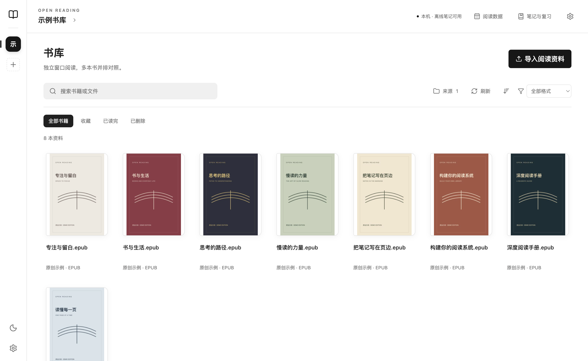
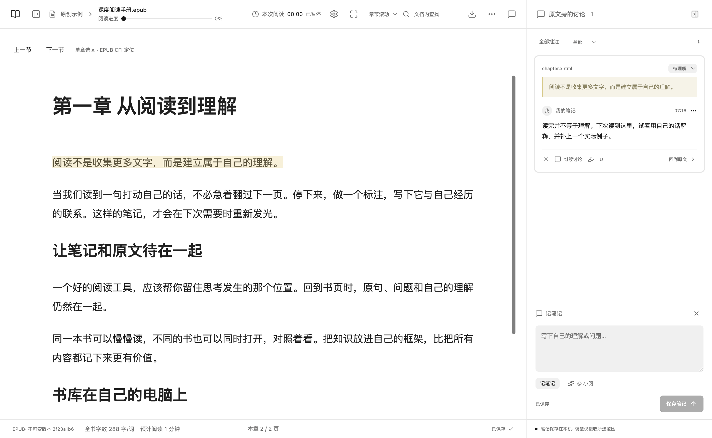

# Open Reading

**读不懂，划一下，直接问 AI。**

Open Reading 是以本地为主的阅读与笔记工具，支持 **EPUB、PDF、Markdown、TXT**。选中原文就能提问，围绕这段内容继续追问，让问题、原文和自己的理解留在一起；也支持 PDF / EPUB 互转，书籍与笔记保存在自己的电脑上。

**MIT 开源 · 预览版 · 中英文界面**

[English](README.md) · [下载安装](https://github.com/gdpu11/openreading/releases) · [已知限制](docs/known-limitations.md)

## 主要功能

- **划线问 AI**：选中原文，点击「问小阅」，解释概念、举例、翻译，或讨论如何应用；围绕原文继续追问，在书页旁保留讨论和自己的笔记。支持自行配置兼容的模型服务，发送前可以预览上下文。
- **PDF / EPUB 互转**：PDF 可保留原版页面图片或提取文字重排；桌面端可将 EPUB 重新分页导出 PDF。生成独立的新文件，保留原书和原有笔记，标注不迁移到新格式。
- **电脑就是书库**：导入文件或连接目录，本机阅读、记笔记无需云端账号和服务器。
- **多窗口阅读**：同时打开多本书对照；EPUB 章节滚动、单页和双页；PDF 连续滚动、双页、快捷键与触控板缩放。
- **标注与学习笔记**：划线、评论、笔记复习，使用 `.ord` 导出原书与已保存标注，供别人独立导入。
- **局域网同步**：电脑确认设备授权后，Android 手机同步指定工作区；支持离线缓存、笔记回传和冲突草稿保留。
- **阅读数据**：前台阅读计时、全局阅读日历、连续阅读天数、全书字数和可调整速度的预计阅读时间。
- **书库管理**：封面、搜索、排序、格式筛选、收藏、已读标记；删除时区分移出当前书库和删除原始文件。

## 体验划线提问

1. 打开 **设置 → 模型与隐私**，添加兼容 Chat Completions 的提供方，填写接口地址、API Key 和模型，并为当前工作区启用。
2. 打开书籍，选中一段原文，点击浮动工具栏中的 **问小阅**。
3. 输入问题，或使用 **通俗解释、举个例子、翻译、如何应用**。选择「仅选段」或「选段与附近内容」，通过 **预览发送内容** 检查上下文，再发送给小阅。
4. 在同一条讨论里继续追问，把自己的理解记在原文旁。

例如，先问「这段话是什么意思？请用一个具体例子解释」，再追问「这个方法可以怎么用到我的工作中？」。

AI 是可选功能，需要自行配置模型服务，可能产生服务商费用。所选上下文和相关问答历史会发送到你配置的服务商；普通阅读、划线和笔记不依赖模型。

**格式转换入口**：在书库中右键书籍，选择「转换为 EPUB」或「转换为 PDF」。PDF 转 EPUB 可选原版页面图片或文字重排，EPUB 转 PDF 需要使用桌面端。转换在本机执行；复杂排版可能变化，扫描 PDF 不做 OCR。

## 平台说明

macOS / Windows 使用 Electron；Android 使用 Capacitor。iOS 提供源码和模拟器构建，**暂时没有 App Store / TestFlight 安装入口**。桌面预览包尚未商业签名或公证，Android 包用于调试；构建通过不等于已在所有真机完成验证。

构建步骤见 [英文 README](README.md#build-from-source) 和 [原生客户端说明](docs/native-clients.md)。推荐先用示例资料体验，并备份自己的书库。

## 隐私与限制

书籍与笔记默认保存在本机，开启局域网同步后才向配对设备提供授权内容。模型接口是可选功能，所选上下文会发送到你配置的服务商；密钥仅保存在服务进程内存，不进入备份。

扫描 PDF 不做 OCR；文字重排可能丢失复杂版式和插图。删除原始文件是永久操作；仅移出书库可以恢复。更多边界见 [已知限制](docs/known-limitations.md)。

公开仓库只包含自有生成的示例书籍，不包含个人书库、部署记录、密钥或本机测试截图。源码使用 [MIT 许可证](LICENSE)，依赖遵循各自许可证。
